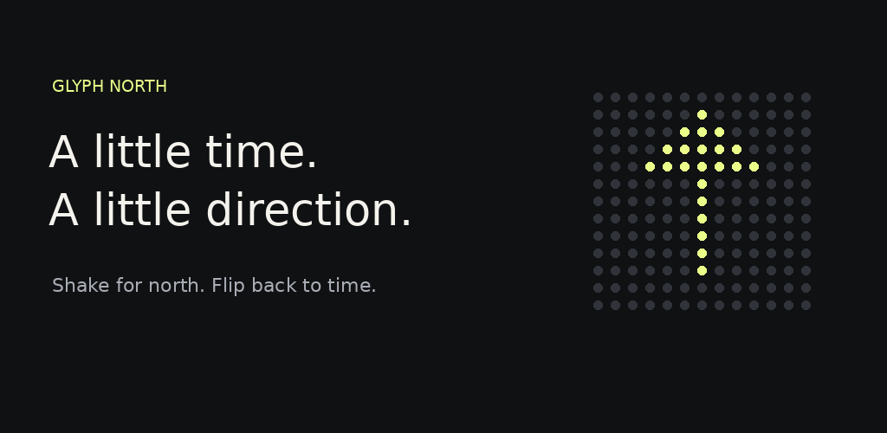

<p align="center">
  
</p>

<h1 align="center">Glyph North</h1>

<p align="center">A little time. A little direction.<br>A clock and shake-to-compass experience for your Nothing Glyph Matrix.</p>

<p align="center">
  <a href="https://github.com/x-does/nothing_compass/releases/tag/v1.6.0-beta.1"><strong>Download the Android beta</strong></a>
  · <a href="#how-it-works">How it works</a>
  · <a href="https://github.com/x-does/nothing_compass/issues">Report a problem</a>
</p>



## What is this?

Glyph North brings a **24-hour clock and magnetic compass to the rear Glyph Matrix** of compatible Nothing phones. Start it once, put your phone face down, and use a shake to switch from time to direction.

This repository is the official project home and download location while we prepare for Google Play. **The app is not yet available on Google Play.** Current downloads are public test builds, not a finished production release.

## How it works

1. **Start Glyph.** The rear display shows time: hours on the top row, minutes below.
2. **Shake for north.** Hold the phone screen down / Glyph up for a moment, then give it a short, deliberate shake with two movement impulses.
3. **Flip back to time.** Turn the front screen face up briefly. The clock returns.
4. **Stop when finished.** Use the app, its notification, or the Quick Settings tile.

### A shortcut, too

Tap **Add Quick Settings shortcut** in the app. Each tile tap cycles **Off → Time → Compass → Off**. Hold the tile to open the app.

Brightness and rear display orientation are adjustable in **Settings**. Connection details and calibration help are there when you need them.

## Supported phones

| Phone | Rear display | Status |
|---|---|---|
| Nothing Phone (4a) Pro | 13×13 Glyph Matrix | Primary development device; live output confirmed by a tester |
| Nothing Phone (3) | 25×25 Glyph Matrix | SDK integration included; physical verification pending |
| Other Android phones | On-screen preview only | No rear Glyph control |

Android 14 or newer is required. The reported test handset is an A069P / FroggerPro running Android 17, Nothing OS build `C5.0-261021-1625`. Firmware behavior may differ.

**The regular Phone (4a) uses different Glyph hardware and is not supported for rear output.**

## Download and install

**[Download Glyph-North-1.6.apk](https://github.com/x-does/nothing_compass/releases/download/v1.6.0-beta.1/Glyph-North-1.6.apk)**

[Release notes and checksum](https://github.com/x-does/nothing_compass/releases/tag/v1.6.0-beta.1)

1. Download the APK on your phone and open it from Files or your browser's downloads.
2. If Android asks, allow **Install unknown apps** for that browser/file manager, then install.
3. Enable **Glyph Interface** in your phone's Settings.
4. For live mode, **deselect Glyph North under Flip to Glyph → Always-on Glyph Toy**. System toys have higher display priority and can hide live output.
5. Open Glyph North, tap **Start Glyph**, and allow notifications for the visible Stop control.

The APK is **debug-signed for beta testing**. It can update existing project test installations using the same key. Moving to a future production/Play signing key may require uninstalling the beta, which removes local preferences. No root, ADB, account or Accessibility service is needed for this app.

## Beta status: please read

- **Screen-off reliability is still under investigation.** Earlier builds froze or stopped displaying after notifications or extended screen-off use. Recovery and mode-ownership fixes have been added, but sustained device testing has not established that all failures are resolved.
- Shake sensitivity, the redesigned UI, and long-running behavior need more real-device feedback.
- The arrow points to **magnetic north**, not geographic true north. Hold the phone level and away from magnets, speakers and metal. An X indicates poor sensor accuracy or excessive tilt.
- Live output keeps a foreground service, motion sensors and a CPU wake lock active. **It uses battery until stopped.**
- Other system Glyph activity may temporarily override the app.

If it stops working, open **Settings → Connection details → Copy details** before restarting and include the report in an [issue](https://github.com/x-does/nothing_compass/issues). Review device/build information before posting it publicly.

## Privacy

No internet permission, ads, analytics, account or location permission. Sensor processing stays on the phone. Preferences and connection diagnostics are stored locally; Android backup and device transfer are excluded. Reports leave the app only when you choose to copy and share them.

[Read the privacy policy](PRIVACY.md).

## Build it yourself

Linux x86-64, with `curl`, `unzip`, `tar` and internet for the initial tool downloads:

```bash
git clone https://github.com/x-does/nothing_compass.git
cd nothing_compass
./scripts/setup.sh
./scripts/build.sh
```

The setup script downloads JDK 17, Android build tools/platform and a pinned, checksum-verified official Glyph Matrix SDK. Google SDK licence acceptance is interactive. Build output: `dist/Glyph-North-1.6.apk`. Tools, vendor AARs, signing credentials and generated APKs are excluded from Git; download published APKs from Releases.

- [Glyph development research](docs/GLYPH-DEVELOPMENT.md)
- [Quick Settings implementation](docs/QUICK-SETTINGS.md)
- [Play submission preparation](store/RELEASE-CHECKLIST.md)
- [Store listing draft](store/listing.md)

Debug/release builds, 11 unit tests per variant, lint and test APK signature verification passed locally. Those checks do not replace physical-device acceptance testing.

## Project and vendor notices

Glyph North is an independent community project, **not affiliated with or endorsed by Nothing Technology Limited**. Nothing's Glyph Matrix SDK is proprietary and governed by [its own licence](https://github.com/Nothing-Developer-Programme/GlyphMatrix-Developer-Kit/blob/999b1143a6bff0dd79db11d21b92c15c56a346b1/LICENSE.md). That licence restricts redistribution except as authorized and requires prior written permission for commercial use. Public distribution/licensing confirmation is part of the release preparation; this beta is not a claim of vendor approval. The repository does not grant rights to the vendor SDK.
